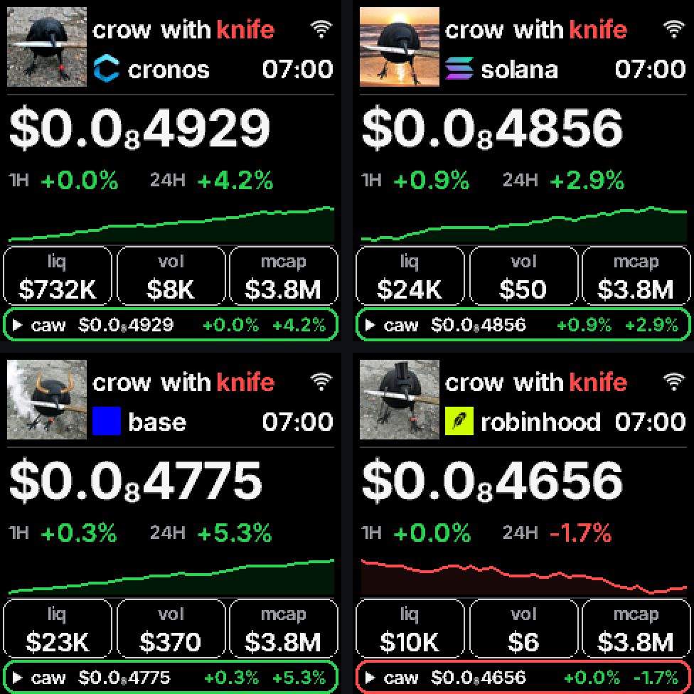
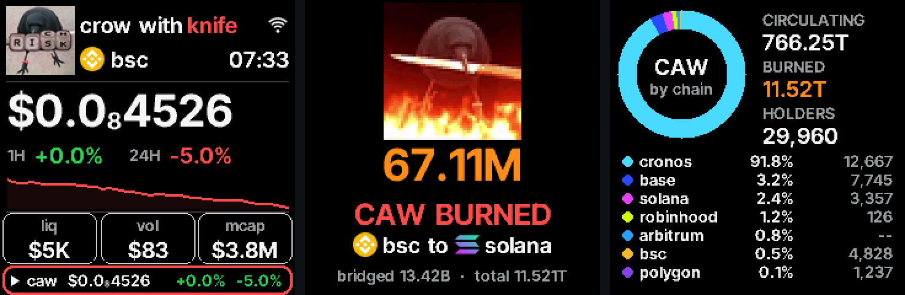
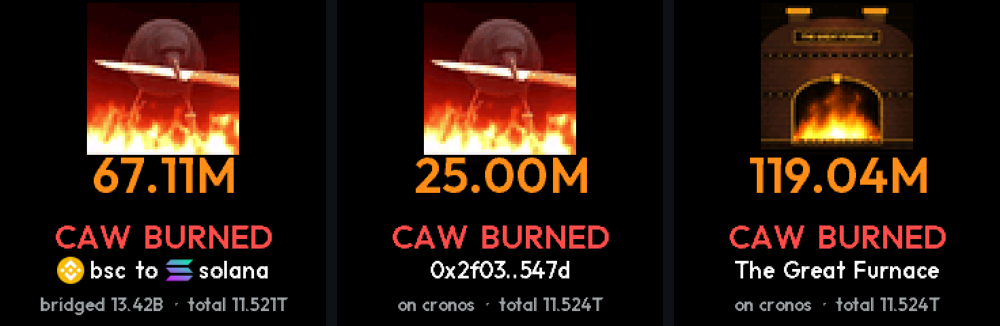

# crow with knife - Clock Firmware

Custom firmware that turns a **JUZIPi SD PRO** desk clock (either board:
ESP8266 ESP-12F, or ESP32-C2 on newer clocks; 4 MB flash, 240 × 240 ST7789
display) into a live **CAW (crow with knife)** display. It runs on its own: no Home Assistant, server or account.







## What it shows

- CAW price with a subscript zero count (`$0.0₈4785`), 1H and 24H change
- a 24-hour price chart, filled in from history right after the first start
- liquidity, 24H volume and market cap
- green or red by the 24-hour move; the ticker ring turns grey when the data
  is stale
- the time (your time zone, 12- or 24-hour) and Wi-Fi state
- a price alert: when a chain makes a big move in an hour, the clock jumps to
  it and the price flashes green (up) or red (down) for 5 minutes
  ([picture](docs/price-alert.png))
- a burn alert: when someone bridges CAW, the 0.5% the bridge burns takes over
  the screen for 20 seconds, with the route and each chain's logo ("bsc to
  solana"), the amount bridged and the total burned
  ([picture](docs/burn-alert.png)); CAW sent straight to the Cronos dead
  wallet gets an alert too, with who burned it (The Great Furnace's burns
  have their own picture)
- a supply screen: where CAW is, with each chain's share in a ring, the
  circulating supply, total burned and holders
  ([picture](docs/supply-screen.png))

It rotates through the main CAW pool on **Cronos, Solana, Base,
Robinhood and BSC**, each with its chain logo.
You choose the chains and the time on
each in the settings page. Market cap is always the overall CAW figure.

Prices come from DexScreener, with GeckoTerminal as a backup and for chart
history, over HTTPS with certificate checks.

Burns come straight from the blockchains: the clock asks public
blockchain servers (RPC) on Cronos, BSC, Base, Polygon, Arbitrum and
Robinhood for the bridge's burn events every few minutes (on Cronos also for
CAW sent to the dead wallet), and Solana's for its CAW supply. The total
burned is counted the way the CAW Discord's burn bot counts it.

The supply screen adds up each chain's CAW supply from the same blockchain
servers; holder counts come from GeckoTerminal (Solana counts both CAW
tokens, as the CAW site does).

## Install

**Step-by-step guide for every route, setup and troubleshooting:
[INSTALL.md](INSTALL.md).** In short:

Already on v0.4.0 or later? Settings page → **System** → **Check for
updates** → **Install**. Otherwise, download the file for your board from the
[latest release](https://github.com/caw7777/caw-clock/releases/latest)
and check it against `SHA256SUMS.txt`: `caw-clock-<version>.bin` for the
ESP8266 board, `caw-clock-sdc2-<version>.bin` (or the installer below) for the
ESP32-C2 board. Not sure which board? The factory update page takes files
starting with `SDP` (ESP8266) or `SDC2` (ESP32-C2).

| Clock is running | How to install |
|---|---|
| CAW Clock firmware | Settings page → **System** → **Install a file**: choose the `.bin` → **Install firmware** |
| [Home Assistant Mini Display](https://github.com/piotrkochan/homeassistant-minidisplay) firmware | Its **Firmware** page → upload the `.bin` |
| The original (stock) firmware, **ESP32-C2 board (SDC2)** | Factory web page → **Firmware Update (OTA)** → `SDC2-CAW-Clock-Installer-<version>.bin`. It joins the clock's Wi-Fi, downloads and checks CAW Clock, and starts it ([details](INSTALL.md#d-from-the-factory-firmware-sdc2)). |
| The original (stock) firmware, ESP8266 board | Its web page → firmware update → `SDP-CAW-Clock-Installer-<version>.bin`. It opens a setup network for your Wi-Fi, clock password and time zone, then downloads, checks and installs CAW Clock ([details](INSTALL.md#c-from-the-factory-firmware)). |

Don't unplug the clock while it restarts after an install.

## First-time setup

1. The clock shows **Set up CAW Clock** with a network name
   (`CAW-Clock-XXXXXX`) and a key.
2. Join that network with the key. Your phone may say "no internet": stay
   connected. Open `http://192.168.4.1`.
3. Pick your Wi-Fi from the list (2.4 GHz only), enter its password, choose a
   clock password (8–32 characters) and check the time zone (preselected from
   your phone).
4. The clock joins your Wi-Fi and shows its settings-page address for a few
   seconds. Sign in there as **admin** with the clock password.

If it can't join, it says why ("network not found", "check the Wi-Fi
password") and reopens the setup network after 2 minutes.

**ESP32-C2 board after its installer:** the clock joins the Wi-Fi it already
used and shows its settings-page address, without a setup network. Open it
and straight away set a clock password (**System** tab) and your time zone
(**Display** tab; until then the clock shows UTC).

Forgot the clock password? Plug the clock in 3 times in a row, each time for
under 10 seconds: it opens its setup network for 15 minutes so you can set a
new one. Settings and memes are kept ([details](INSTALL.md#troubleshooting)).

## Settings page

`http://<clock address>/` (sign in as **admin**):

Four tabs:

- **Status**: price and last update for each chain; total burned, the last
  burns (each with a link to its transaction) and each chain's last check;
  the clock's address, signal and memory
- **Display**: brightness, night mode, chains (Cronos, Solana, Base,
  Robinhood, BSC), time on each chain, price alert, burn alert (on/off,
  **Preview the burn alert**), supply screen (on/off), 12- or 24-hour clock,
  time zone (63 zones)
- **Memes**: rotation, and the meme library (add, hide, delete, show all /
  hide all)
- **System**: Wi-Fi, clock password, check for updates, firmware install,
  restart, factory reset
- `http://<clock address>/api/status`: everything as JSON, including memory
  and the last restart reason

## Giving the clock away

Use **Factory reset** on the settings page. It erases the Wi-Fi details,
password and all settings; the clock starts in setup mode. Nothing personal
is built into the firmware (the default time zone is UTC).

## Safety and security

- Price and burn data: HTTPS with certificate validation (GTS, ISRG, SSL.com
  and USERTrust roots).
- Settings page: HTTP on your network with Digest sign-in, so the password is
  never sent in clear; page content isn't encrypted.
- Firmware uploads need the clock password (or the setup network, whose key is
  only shown on the clock's screen). Images are not signed.
- Without a clock password, the settings page answers only at the clock's
  own address or network name, so a website can't reach it through a domain
  pointed at the clock (DNS rebinding). Set a password anyway.
- **Recovery mode:** three quick power-ons (each under 10 seconds) open the
  setup network for 15 minutes to set a new clock password. Like setup, it
  needs the key shown only on the clock's screen. Nothing is erased.
- **Safe mode:** after three quick restarts in a row the clock stops fetching
  prices and keeps the settings page and firmware upload working.
- **Updates from the settings page** are downloaded from this repository's
  releases over HTTPS and installed only if their SHA-256 matches the
  release's `SHA256SUMS.txt`. The clock checks once a day (and when you press
  **Check for updates**); a newer version shows a small green dot next to the
  Wi-Fi icon and a notice on the settings page. It installs only when you
  press **Install**.
- **Built-in backup:** while an update is installing, the clock keeps a copy of
  the current version (about 1 MB of meme storage, freed again after 10
  minutes) and returns to it automatically if the new version doesn't start
  correctly. Without room for the copy, the settings page says so and the
  update goes ahead without it. The ESP32-C2 board keeps the previous version
  in its second program slot instead, and goes back to it if a new version
  keeps crashing when it starts.

## Building

The firmware source is in `caw-working-source.zip` (PlatformIO 6.1.19,
`espressif8266@4.2.1`, Python 3.12). To build the release firmware yourself:

```sh
unzip caw-working-source.zip -d build && cd build/caw-working
pip install "platformio==6.1.19"
(cd firmware && pio pkg install -e sdpro)
make test-native                      # native unit tests
cd firmware && pio run -e sdpro_caw_standalone
```

The image is `firmware/.pio/build/sdpro_caw_standalone/firmware.bin`; it must
stay under the 1,044,464-byte OTA slot.

**ESP32-C2 board (SDC2):** `caw-c2/` builds the same app, compiled from the
same sources, on ESP-IDF 5.5 ([pioarduino](https://github.com/pioarduino/platform-espressif32),
which needs PlatformIO Core 6.2, the version the release workflow pins), after
the ESP8266 build above (it reuses that build's ArduinoJson):

```sh
pip install "platformio @ https://github.com/platformio/platformio-core/archive/d8c21353ee2eccae6ecb5a3a95f8e75612e8887a.zip"
cd caw-c2 && pio run                  # caw-c2/.pio/build/sdc2/firmware.bin, at most 1,572,864 bytes
export CAW_INSTALLER_VERSION=<version> CAW_INSTALLER_SHA256=<sha256 of caw-clock-sdc2-<version>.bin>
cd installer && pio run               # the installer, at most 786,432 bytes
```

### CI

| Workflow | Runs | Does |
|---|---|---|
| Build CAW standalone | changes to the source zip | CAW firmware (`sdpro_caw_standalone`) + native tests |
| Release CAW Clock firmware | a release is published (or manual dry run) | builds both boards' firmware and installers and attaches the release files |
| Build CAW TLS probe | changes to the source zip | HTTPS test firmware (`sdpro_caw_probe`) |

### Release files

| File | What |
|---|---|
| `caw-clock-<version>.bin` | the firmware (ESP8266 board) |
| `caw-clock-sdc2-<version>.bin` | the firmware (ESP32-C2 board) |
| `SDP-CAW-Clock-Installer-<version>.bin` | installer for ESP8266 clocks on their stock firmware |
| `SDC2-CAW-Clock-Installer-<version>.bin` | installer for ESP32-C2 clocks on their factory firmware |
| `SHA256SUMS.txt` | checksums of all files |
| `caw-clock-<version>-source.tar.gz` | project source used for the build |
| `caw-clock-<version>-relink.tar.gz` | ESP8266 core, SDK and libraries as built, plus compiled objects, for rebuilding with a modified core (LGPL); see `RELINKING.md` inside |
| `LICENSE`, `THIRD_PARTY.md` | licences and third-party notices |

Asset scripts (run by hand, outputs committed): `caw_chain_icons.py`
(chain logos), `caw_memes.py` (bundled memes), `caw_furnace.py` (The Great
Furnace's burn picture), `caw_timezones.py` (time zones from the IANA
database).

Changes: [CHANGELOG.md](CHANGELOG.md).

## Licence

MIT, see [LICENSE](LICENSE). Based on
[Home Assistant Mini Display](https://github.com/piotrkochan/homeassistant-minidisplay)
by Piotr Kochan (MIT). Third-party components keep their own licences, listed
in `THIRD_PARTY.md` (in the source zip and attached to every release). Chain
logos are trademarks of their owners and only identify which chain is shown.
The built-in memes are community images and are not covered by the MIT licence.
